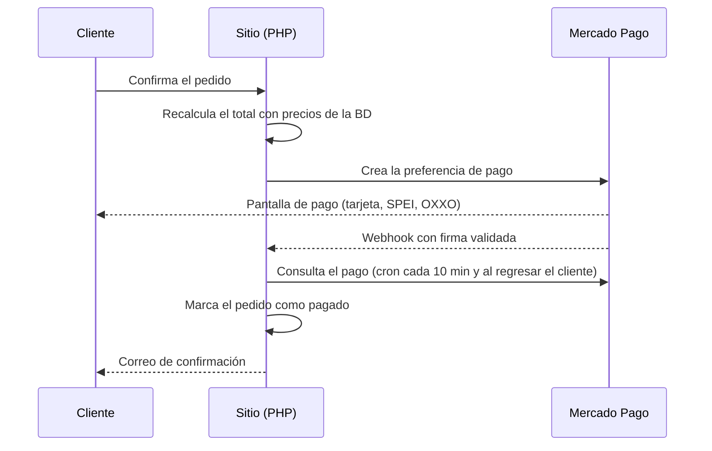

# Yaxché México — Tienda en línea y programa de embajadores

Plataforma web para **Yaxché México**, laboratorio mexicano que elabora y comercializa suplementos alimenticios. Incluye una tienda en línea con pagos de Mercado Pago, un panel de administración y un programa de embajadores de marca con niveles, contratos digitales y firma en línea.

> **Nota:** el código fuente es privado porque pertenece al cliente. Este repositorio documenta el proyecto: qué hace, cómo está construido y las decisiones técnicas que tomé.

**Sitio en producción:** [yaxchemexico.com.mx](https://yaxchemexico.com.mx)

---

## Contexto

Proyecto de **Residencia Profesional** de Ingeniería en Sistemas Computacionales, TecNM Campus Acapulco (agosto–diciembre 2026). Desarrollé la plataforma completa de forma individual, desde el diseño hasta la puesta en producción.

**Nombre oficial:** *Desarrollo de una plataforma web para la gestión comercial, el seguimiento de embajadores de marca mediante el monitoreo de indicadores clave de desempeño (KPI) y la optimización de procesos administrativos.*

Antes del proyecto, la empresa vendía principalmente por recomendación. La plataforma le dio un canal de venta en línea con cobro automático y una forma de administrar a su red de embajadores.

---

## Funcionalidades

### Tienda en línea
- Catálogo de más de 170 productos en 22 categorías, organizado por líneas (nutracéuticos, vitaminas y minerales, plantas, compuestos, infusiones, deportivo y kids), con búsqueda y filtro por línea.
- Carrito persistente y cuentas de cliente con historial de pedidos.
- Calificaciones de productos **solo de compradores verificados** cuyo pedido ya fue entregado.

### Checkout y pagos
- Checkout en 4 pasos: datos → entrega → pago → confirmación.
- Envío a domicilio o **recoger en sucursal** (en ese caso no se cobra envío).
- **Mercado Pago Checkout Pro**: tarjeta, saldo de Mercado Pago, SPEI y efectivo en OXXO.
- El total se recalcula en el servidor con los precios de la base de datos; el precio que manda el navegador nunca se usa para cobrar.
- Si el cliente ya tiene un ticket de OXXO vigente para el mismo carrito, se reutiliza en lugar de generar otro.
- Correos transaccionales (confirmación de compra y aviso de pedido) con un cliente SMTP propio con TLS.

### Conciliación de pagos
- Webhook con validación de la firma `x-signature` (HMAC-SHA256).
- **Conciliación activa:** un cron cada 10 minutos consulta a la API de Mercado Pago el estado de los pedidos pendientes, con una ventana de 7 días para pagos en OXXO. También se consulta cuando el cliente regresa a la página de éxito.
- Un cron diario detecta reembolsos y contracargos y avisa por correo al área de ventas.

### Programa de embajadores
- Registro con identificación oficial y aprobación desde el panel de administración.
- **Contrato de afiliación generado automáticamente** a partir de la plantilla de la empresa y entregado en PDF.
- **Firma en línea** con mouse o con el dedo, mediante un enlace personal con vencimiento. El PDF firmado guarda una huella digital del documento y la IP de firma.
- Claves de afiliación y códigos de empresario únicos generados automáticamente.
- Kit de inscripción que activa los beneficios del embajador.
- **5 niveles por color** (Rojo → Amarillo → Negro → Blanco → Verde) según el acumulado de compras, cada uno con su descuento. El descuento se calcula de forma proyectada: si una compra sube al embajador de nivel, esa misma compra ya obtiene el nuevo descuento.
- Portal del embajador con su nivel y sus pedidos.

### Panel de administración
- Productos, categorías y líneas, con importación del catálogo real.
- Contenido editable del inicio (slides y destacados), de "Nosotros" y de "Desarrollo e investigación" (con PDFs descargables).
- Pedidos, embajadores y sus compras, niveles y descuentos, calificaciones y mensajes de contacto.
- Recuperación de contraseña por correo para administradores, embajadores y clientes.

### Integración con Aspel SAE 10
- Endpoint que recibe las existencias del ERP de la empresa y actualiza el inventario de la tienda haciendo coincidir por SKU.
- Las peticiones van firmadas con HMAC (marca de tiempo + cuerpo) y se rechazan si la firma no coincide o la marca de tiempo está fuera de la ventana permitida.

---

## Cómo funciona el cobro

---

## Seguridad

- Credenciales (base de datos, Mercado Pago, SMTP) **fuera de la carpeta pública**, leídas desde variables de entorno.
- Consultas con PDO y sentencias preparadas.
- Tokens CSRF en los formularios y honeypot antispam en el formulario de contacto.
- Contraseñas con `password_hash`; los tokens de recuperación se guardan hasheados y caducan.
- Bloqueo temporal tras varios intentos fallidos de inicio de sesión: por IP y por correo en el panel de administración, y por cuenta en el portal de embajadores.
- Documentos personales de los embajadores (identificaciones, firmas y contratos) en una carpeta privada bloqueada desde la web.
- Carpeta de archivos subidos sin ejecución de PHP.
- Cabeceras de seguridad (`X-Frame-Options`, `X-Content-Type-Options`, `Referrer-Policy`, `Permissions-Policy`) y bloqueo de archivos sensibles desde `.htaccess`.
- Las tareas programadas solo se pueden ejecutar desde la línea de comandos, no desde el navegador.

---

## Retos y decisiones técnicas

- **Los avisos de Mercado Pago no llegaban al servidor.** En vez de depender del webhook, diseñé una conciliación activa que consulta el estado de cada pago. El sistema confirma los pedidos aunque el aviso nunca llegue.
- **Nunca confiar en el navegador para cobrar.** El servidor recalcula el total con los precios de la base de datos antes de crear el pago.
- **Contratos sin Word en el servidor.** El contrato se genera en PDF con FPDF/FPDI sobre la plantilla de la empresa, en un hosting compartido sin Composer.
- **Descuento proyectado.** El embajador ve en el carrito el descuento del nivel que alcanzará con esa misma compra, sin esperar a la siguiente.
- **Dominio con el correo en otro proveedor.** El sitio se conectó con un registro A, sin tocar los nameservers ni los MX donde vive el correo de la empresa.

---

## Tecnologías

| Área | Tecnología |
|---|---|
| Backend | PHP 8, PDO |
| Base de datos | MySQL |
| Frontend | HTML, CSS y JavaScript sin frameworks |
| Pagos | Mercado Pago Checkout Pro (SDK `dx-php`) |
| PDF | FPDF + FPDI |
| Códigos de barras | JsBarcode (CODE128, generado en el navegador) |
| Correo | Cliente SMTP propio con TLS |
| ERP | Aspel SAE 10 |
| Hosting | Hostinger (cron jobs en hPanel) |
| Control de versiones | Git y GitHub |

---

## Mi rol

Desarrollador full-stack del proyecto completo:

- Migración del sitio estático original a PHP con contenido administrable.
- Tienda, carrito, checkout y cuentas de cliente.
- Integración con Mercado Pago y diseño de la conciliación de pagos.
- Programa de embajadores: registro, niveles, descuentos, contratos en PDF y firma en línea.
- Panel de administración.
- Integración de inventario con Aspel SAE.
- Seguridad de la aplicación y manejo de datos personales.
- Puesta en producción en Hostinger: dominio, correo SMTP y tareas programadas.

---

## Contacto

- GitHub: [@ZzLeoG](https://github.com/ZzLeoG)
- Correo: [LeonardoGXD@gmail.com](mailto:LeonardoGXD@gmail.com)
